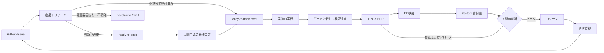

# Factory：ソフトウェアファクトリーの参照実装

ソフトウェアファクトリーとは、ソフトウェアを届ける作業を繰り返し可能にする仕組みです。Issueごとに新しいエージェントのセッションを開いて手作業で誘導する代わりに、着手してよい仕事、仕事の開始方法、必要な証拠、人間が判断する境界を定義します。

このリポジトリは、標準のClaude Codeを使って、その運用モデルを既存のGitHubプロジェクトへ導入します。薄いCodexアダプターも同じポリシー、キュー、ゲート、証拠ファイルを使います。独自のオーケストレーターやキューサービスを動かす必要はありません。

**具体的には：** GitHub Issuesを作業キューにします。定期実行するエージェントがキューをトリアージし、範囲を限定したタスクを実装し、実際のテストを実行し、独立レビューを受けて、ドラフトのプルリクエストを作成します。曖昧な要件、システム設計、重要な基盤部分の変更、すべてのマージは、人間が責任を持ちます。

## 得られるもの

設定を済ませると、ファクトリーは次のことができます。

- 新しいGitHub Issueを調べ、実装、仕様策定、明確な質問、既知の阻害要因のいずれかへ振り分ける
- 憲章が明示的に許可した小さな仕事を選び、他の実行と競合せず担当を確保し、ブランチ上で実装してドラフトPRを作る
- 型、lint、テスト、ビルド、監査、アーキテクチャの決定的な検査を実行し、必須検査がなければ安全側に倒して失敗させる
- 新しい検証担当に事前説明なしで差分を読ませ、実装がなければ新しいテストが失敗することを証明させる
- 作成されたPRを検証し、レビュー待ちキューを可視化し、その数が上限に達したら新規作成を止める
- デフォルトブランチとファクトリーの健全性を監視し、発見事項を新しいGitHub Issueとして戻す

価値が生まれるのはコード生成の後です。エージェントが無人で着手してよい仕事、独立した実行間の引き継ぎ、人間の最終判断に渡す証拠を、バージョン管理された手順として定めます。

## 基本的な考え方

このリポジトリに常駐するファクトリープロセスはありません。リポジトリはルールと手順を提供します。標準構成ではClaude Codeのクラウドルーティンがスケジュールと計算資源を提供します。永続的なキューとPRはGitHubに置きます。各実行は新しい状態から始まり、1つの段階を処理し、証拠を記録して終了します。

| ファクトリーの概念 | 具体的な仕組み |
|---|---|
| 意図と許容リスク | 人間が管理する `docs/factory/CHARTER.md` |
| 作業キュー | `factory:*` ラベル付きのGitHub Issues |
| 段階間の引き継ぎ | 構造化された `factory-handoff:v1` Issueコメント |
| 標準作業手順 | バージョン管理されたClaude/Codexスキル |
| スケジュールとトリガー | Claudeルーティン、スケジュール、GitHubイベント、任意のAPI呼び出しAction |
| 作業担当 | 新しいClaude CodeまたはCodexセッション |
| 品質管理 | プロジェクトのテストコマンド、`gates.sh`、独立した検証担当 |
| 管制室 | 実際のIssue、PR、実行記録を参照する `/factory` |
| リリース権限 | PRをレビューしてマージする人間 |

各ループは短く、再開可能です。大きな目標は、1回の実行で担当を確保して完了できるキュー項目へ分割します。GitHubラベルとコミット済みファイルはセッション終了後も残るため、失敗した実行を調べられます。次の実行や別のハーネスも、会話履歴に頼らず続きを進められます。

## Issueがレビュー済みPRになるまで



例えばIssue `#142` が、期限切れトークンに対して `401` ではなく `500` が返ると報告したとします。

1. 定期トリアージのルーティンがIssueを読み、憲章を確認し、小規模かつ許可された仕事かを判断します。キューラベルを1つ付け、想定ファイル、完了条件、ゲートレベル、確信度を含む引き継ぎを記録します。
2. `factory:ready-to-implement` であれば、後の実装実行が決定的なブランチ名 `claude/fq-142` を使って担当を確保します。最初のpushだけが成功するため、2つの定期セッションが同じIssueを同時に担当することはありません。
3. 実装実行は、失敗するテストを先に書き、範囲内の変更を行い、必須ゲートを実行し、新しい検証担当へ委任します。それらの検査結果が一致した場合だけドラフトPRを作ります。
4. PRの作成で、別の検証ルーティンを起動できます。そのルーティンはゲートを再実行し、スコープを確認して、PRに判定を残します。
5. `/factory` が人間のレビュー待ちキューにPRを表示します。人が証拠を読み、修正要求、クローズ、マージを判断します。ルーティンはマージしません。

トリアージでプロダクトの意図を判断できなければ、Issueを `factory:ready-to-spec` に移し、仕様策定ワークフローは4つの明示的な人間の承認ゲートで停止します。不足している事実が必要なら、推測でコードを書く代わりに質問を付けて保留します。

### 人間が関与し続ける部分

ファクトリーは繰り返しの機械的な誘導を自動化しますが、エンジニアリング上の判断は人間に残します。人間は引き続き次を行います。

- リスク、スコープ、保護対象パス、レビュー待ち上限を定める憲章を書く
- 仕様策定が必要な仕事のプロダクトの意図、観測可能な動作、技術設計、実装単位を承認する
- 重要な基盤コードと既存テストへの変更を読む
- すべてのPRについてマージすべきかを判断する
- ファクトリー自身の制約に対する変更案を承認または却下する

エージェントはIssueの分類、キューラベルの移動、許可された仕事の実装、検査、ドラフトPR作成を行えます。黙って範囲を広げる、憲章を書き換える、自分の仕事を承認する、マージすることはできません。最終的な強制境界はGitHubのブランチ保護です。

### GitHubから仕事を開始する方法

図の最初の矢印には、現時点の製品制約が関係します。[Claudeルーティン](https://code.claude.com/docs/en/routines)にはPRとリリースのネイティブGitHubトリガーがありますが、新規Issue用はありません。
この参照実装は、毎時のトリアージルーティンで未分類Issueをポーリングします。これが最も単純で信頼できる標準構成ですが、Issueは次回の実行まで待つことがあります。

即時トリアージが必要なら、任意のGitHub Actionを導入します。Issueイベントを受けてトリアージルーティンのAPIエンドポイントを呼び出します。PR検証にはネイティブの `pull_request.opened` トリガーを使えます。[LIMITS.md](LIMITS.md)でトリガーの境界とトレードオフを詳しく説明しています。

## Claude CodeとCodexの役割

ファクトリーの手法は共通ですが、この参照実装の無人自動化はClaudeを中心に構成しています。

| 機能 | Claude Code | Codex |
|---|---|---|
| プロジェクトポリシー | `CLAUDE.md` と共通の憲章・契約 | `AGENTS.md` と同じ憲章・契約 |
| 繰り返し可能な段階 | `.claude/skills/` 内の正規スキル | `.agents/skills/` 内の薄いアダプター |
| 対話的トリアージ・仕様策定・実装・状況確認 | 対応 | 対応 |
| 決定的ゲートとGitHubキュー | 共通 | 共通 |
| このリポジトリが提供する無人スケジュール | Claudeクラウドルーティン用の5つのプロンプト | 自動作成しない |
| ここで使うネイティブGitHubトリガー | PR検証 | この参照実装には含めない |

Codexでも同じ段階を対話的に実行でき、利用可能なCodexの目標機能や自動化機能へ対応付けることもできます。このリポジトリは、それらのスケジュールを作成せず、ライフサイクルがClaudeルーティンと同じだとも主張しません。どのハーネスが実行を開始しても、キューはGitHubラベル、ポリシーは共通契約です。

Codexは [`AGENTS.md`](https://learn.chatgpt.com/docs/agent-configuration/agents-md) を読み、[リポジトリスキル](https://learn.chatgpt.com/docs/build-skills)を検出し、コミット済みの[リポジトリフック](https://learn.chatgpt.com/docs/hooks)を読み込めます。アダプターは別実装を維持せず、正規のClaudeワークフローを参照します。

## ここから始める

このリポジトリは、別のプロジェクトへ導入するインストーラーです。クローンし、自動化対象のリポジトリに対して `install.sh` を実行してから、対象リポジトリをコーディングエージェントで開いてください。

- **どこまで仕組みが必要か迷っていますか？** [ADVICE.md](ADVICE.md)で、標準のClaude Code/Codexから始める方法、検証に割く予算、Factoryの追加構造が役立つ条件を説明しています。
- **まず全体のループを見たいですか？** [Reel Goodデモ](https://github.com/addyosmani/factory-demo)と[段階的なワークショップ](https://github.com/addyosmani/factory-demo/blob/main/docs/WORKSHOP.md)で、Claude Code DesktopまたはCodexを使って小さなTMDB映画アプリへFactoryを適用できます。
- **デスクトップアプリから始めますか？** [GETTING_STARTED.md](GETTING_STARTED.md)には、Claude Code DesktopとCodex/ChatGPT Desktopそれぞれの手順、最初に貼り付けるプロンプト、書き込みを有効にする前の検査があります。
- **Claudeのクラウドセッションとルーティンを使う準備ができていますか？** ローカルのデスクトップでのドライランが安定してから[QUICKSTART.md](QUICKSTART.md)へ進んでください。
- **設計を先に評価しますか？** [ARCHITECTURE.md](ARCHITECTURE.md)と、製品制約を率直に記した[LIMITS.md](LIMITS.md)を読んでください。

```
factory/
├── README.md            <- このファイル
├── ADVICE.md            ハーネスだけで十分な場合とFactoryが役立つ場合
├── GETTING_STARTED.md   デスクトップから始めるローカル設定
├── QUICKSTART.md        Claudeクラウドセッションとルーティン
├── ARCHITECTURE.md      設計の理由
├── ROUTINES.md          そのままコピーする5つのルーティンプロンプト
├── LIMITS.md            率直な制約とよくある計画の訂正
├── CONTRIBUTING.md      変更箇所の案内と検証要件
├── CLAUDE.md            Claude Code向けの開発者指示
├── AGENTS.md            Codex向けの開発者指示
├── install.sh
├── tests/               使い捨てリポジトリでのスモークテスト
└── template/            共通契約とClaude Code/Codexアダプター
```

## インストール

この日本語版は [Addy Osmani による原版 Factory](https://github.com/addyosmani/factory) のフォークです。以下では日本語版をクローンします。

```bash
git clone https://github.com/hiromura16/factory.git
cd /path/to/your/repo
/path/to/factory/install.sh --dry-run .
/path/to/factory/install.sh .
```

続いて[GETTING_STARTED.md](GETTING_STARTED.md)を読んでください。インストーラーは既存ファイルを上書きしないため、再実行しても安全です。

---

## インストールされるもの

| 要素 | ファイル | 役割 |
|---|---|---|
| **憲章** | `docs/factory/CHARTER.md` | 人間が管理する階層、重要な基盤パス、自動化可能な仕事、完了の定義、停止条件 |
| **契約** | `docs/factory/CONTRACT.md` | ハーネスに依存しないキュープロトコル、ポリシー、永続的な証拠の規則 |
| **ゲート** | `.claude/scripts/gates.sh` | 型、lint、テスト、ビルド、監査、ミューテーション、アーキテクチャ。3段階。エージェントが言い換えてはいけない判定行を出力 |
| **実キュー** | GitHub `factory:*` ラベル | 独立した実行間の状態の可視化と引き継ぎ |
| **同時実行時の担当確保** | 決定的な `claude/fq-<n>` ブランチ | 最初の非強制pushが成功し、後続の実行は停止 |
| **トリアージ** | `.claude/skills/factory-triage/` | Issueから実ラベルとレビュー可能なキュースナップショットへ |
| **仕様策定** | `.claude/skills/factory-spec/` | コード作成前に4つの人間の承認ゲート |
| **実装** | `.claude/skills/factory-implement/` | 1項目、テスト先行、ゲート成功、独立検証、ドラフトPR |
| **検証担当** | `.claude/agents/factory-verifier.md` | 事前説明なしで差分を読む。修正を戻してテストが失敗することを証明。不確実なら却下 |
| **批評担当** | `.claude/agents/factory-critic.md` | 重要な基盤変更を対抗的な別視点で検査 |
| **検証** | `.claude/skills/factory-verify/` | GitHubトリガーのルーティンが実行するPR単位の検査 |
| **監視** | `.claude/skills/factory-monitor/` | Issue登録でループを閉じる週次点検 |
| **管制室** | `/factory` | 今、人間が対応すべきこと。レビュー待ちを最優先 |
| **調整** | `/factory-tune` | 月次の制約レビュー。提案のみ |
| **マージガード** | `.claude/hooks/block-merge.sh` | 一般的なシェル経由のマージを阻止。強制境界はGitHubルール |
| **診断** | `.factory/scripts/doctor.sh` | プレースホルダー、ラベル不足、リモート不足、設定の欠落を検出 |

---

## 仕組みを支える4つの考え方

**1. すべてをリポジトリに置く。** クラウドセッションは新しいクローンから始まります。コミット済みの `.claude/` は届きますが、`~/.claude/` は届きません。同じファイル群でターミナル、Desktop、クラウド、ルーティンを動かせるため、設定の同期は不要です。

**2. 自律性は難しさではなく結果の重大さに合わせる。** 憲章の `TIER` が各ルーティンの裁量を定めます。未公開プロジェクトの1万行の移行は、顧客の認証経路に対する50行の変更より安全な場合があります。その違いを設定に明記すべきです。

**3. ゲートスクリプトが判定する。** `gates.sh` の最後の行を、スキルはそのまま引用しなければなりません。必須ゲートがなければ `MISCONFIGURED`、終了コード2です。テストコマンドの欠落が黙って成功扱いになることはありません。

**4. 書いた人は自分の仕事を採点しない。** 実装は、差分を事前説明なしで読み、実装者の説明を無視するよう指示された別の検証担当へ委任します。その最重要の検査は、ゲートだけではできないものです。修正を戻し、テストが本当に失敗することを確認します。

## 削除されがちな2つの制約

**バックプレッシャーは数値で定義する。** 憲章の `STOP_IF` は、レビュー待ちに置ける項目数に上限を設けます。キューが満杯なら実装ルーティンは着手しません。ファクトリーの制約は、動かせるエージェント数ではなく、人間の判断を待つ決定の数です。

**どの階層でもマージは自動化しません。** GitHubルールセットかブランチ保護で強制してください。コミット済みのClaude/Codexフックは一般的なシェル経路を捕捉しますが、完全なセキュリティ境界ではなくガードレールです。

---

## この仕組みを拡張する前に

[LIMITS.md](LIMITS.md)を読んでください。要点は次のとおりです。

- **GitHubの `issues` トリガーはありません。** ルーティンのGitHubトリガーは `pull_request` と `release` のみです。標準ルーティンだけでは「新規Issue → トリアージ」の矢印を実現できません。テンプレートは標準で定期ポーリングし、即時実行が必要な場合にルーティンのAPIを呼ぶ任意のActionを提供します。
- **クラウド環境設定はコミットできません。** ネットワーク、環境変数、セットアップスクリプトはアカウント単位のUI状態です。`CLOUD-ENVIRONMENT.md` に記録してください。
- **実行ステータスが緑でも、タスク成功とは限りません。** インフラエラーなしでセッションが終了したことを示すだけです。
- **環境変数はシークレットではありません。** `GH_TOKEN` は未設定にしてください。GitHubプロキシが認証を処理し、認証情報をVMに置かずに済みます。

LIMITS.mdの第7節では、広く出回っている構築計画を項目別に訂正しています。最も重要な誤りはIssueトリガーです。パイプラインの最初の段階だからです。

## 参照実装の検証

ローカルテストスイートは、使い捨てGitリポジトリを作り、インストール、冪等性、安全側に倒すゲート、決定的な担当確保の競合、マージガード、設定診断、ネガティブテスト後の復元を検証します。

```bash
bash tests/run.sh
```

## ライセンス

[MIT](LICENSE) © 2026 Addy Osmani.

## 参考資料

まずDex Horthyのソフトウェアファクトリーの手引き、[「Harness Engineering Is Not Enough: Why Software Factories Fail」](https://youtu.be/htM02KMNZnk?t=27219)を参照してください。生成よりも人間の判断、検証、長期的な理解の方が拡張しにくいという、最も重要な制約を具体的に示しています。

- [Zach Lloydによるエンジニアリングリーダー向けクラウドソフトウェアファクトリーガイド](https://www.warp.dev/blog/a-guide-to-cloud-software-factories-for-engineering-leaders)は、より大きな組織モデルと `triage → spec → implement → review → verify → ship → monitor` の全体ループを説明しています。
- Warpの実践的な構築シリーズは、[自動トリアージ](https://www.warp.dev/blog/how-to-build-a-cloud-software-factory-the-automatic-triage-skill)から始まり、[仕様駆動開発](https://www.warp.dev/blog/how-to-build-a-cloud-software-factory-add-spec-driven-development-skills)へ続きます。
- Claude Code公式ドキュメントは、ここで使う拡張要素である[プロジェクト指示、スキル、サブエージェント、フック、プラグイン](https://code.claude.com/docs/en/features-overview)を説明しています。
- OpenAI公式ドキュメントは、Codexの[プロジェクト指示](https://learn.chatgpt.com/docs/agent-configuration/agents-md)、[リポジトリスキル](https://learn.chatgpt.com/docs/build-skills)、[フック](https://learn.chatgpt.com/docs/hooks)を説明しています。

この参照実装は、意図的に上記の組織規模の設計より小さくしています。個人のプロジェクト群では、開発者間のばらつきが主な制約ではありません。1人のレビューに向ける注意力が品質管理のすべてです。だからこそ、構成要素を減らし、状態をリポジトリが所有し、保留中の判断に厳格な上限を設けます。
